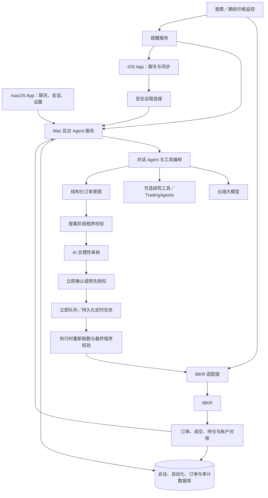

# IBKR AI 助手：目标与任务大纲

更新日期：2026-10-24
状态：需求与架构大纲；尚未实施。具体接口、数据结构和验收方案以 TODO 后续补充。

> 阅读说明：「已确认」来自当前需求；「设计方向」是为满足需求提出的架构；TODO 表示尚未验证或决定，不能当作已经支持的功能。2026-10-24 以前关于“完整量化交易平台、手机交易控制台、三种交易模式”的描述，均以本版为准重新解释。

## 1. 整体目标（已确认）

本项目是一套供个人使用、常驻在 Mac 上的**对话式 IBKR AI 助手**，当前目标不是建设量化交易平台。

### Mac 端

- AI Agent 能聊天、切换会话，并把会话记录持久保存到数据库。
- AI Agent 连接 IBKR，读取必要的账户、持仓、挂单和行情信息，并在获得相应权限后提交订单。
- 用户提出下单意图时，Agent 先检查订单是否合理；不合理时必须拦截并说明原因。
- 支持用户提前授权的定时订单。用户即使在乘机、手机离线或没有打开客户端，Mac 后台服务仍能在约定时间检查条件并决定是否提交。
- 支持股票和期权的价格监控、条件提醒以及其他后续自动化任务。
- 用户仍可使用 IBKR 官方客户端下单；系统同步实际订单、成交、持仓和账户变化。

### iPhone 端

- 连接 Mac 上的 AI Agent，与同一个 Agent 聊天。
- 会话列表、消息、Agent 回复、订单审核结果和自动化提醒与 Mac 端同步。
- 当前不开发独立的手机交易控制台。iPhone 可以在聊天中看到订单方案和执行状态，但“从 iPhone 确认或发出订单”属于后续能力，不能默认开放。

## 2. 当前范围和明确不做的内容

### 当前范围

- Mac 原生聊天客户端与常驻后台 Agent 服务。
- iOS 原生聊天客户端。
- 云端大模型调用；不在 Mac 上运行本地大模型。
- IBKR 账户读取、下单、订单状态跟踪、成交/持仓对账。
- 下单合理性审核、确定性交易规则、定时订单。
- 股票和期权价格监控及通知。
- 会话、消息、工具调用、订单决策和自动化任务的数据库持久化。
- 安全的远程连接、设备认证和实时/增量同步。

### 当前不做

- 量化策略研发、策略组合管理和自动轮询信号交易。
- 大规模历史数据仓库、批量回测和参数优化。
- 手机账户看板、K 线交易终端、改单/撤单表单等完整交易 UI。
- 本地大模型。
- 自动把“价格达到条件”直接转成真实订单；提醒与自动交易是两种不同权限。

如果以后重新需要量化交易，再单独评估 NautilusTrader 的策略、回测和事件引擎，不让这部分增加当前系统的复杂度。

## 3. 总体架构（设计方向）

关键边界：

- macOS App 是交互界面；后台 Agent 服务负责 IBKR 会话、定时任务、监控和数据库。关闭 App 窗口不能停止这些任务。
- iOS App 只连接 Agent API，不直接持有 IBKR 凭据，也不直接连接券商。
- Agent 不能绕过订单校验接口直接调用券商。
- 后端 API 和事件协议保持稳定，使研究组件、Agent 框架或 IBKR 适配层可以替换，而不必重写两端 App。

## 4. 聊天下单与“合理性审核”（核心能力）

这是本项目的核心能力之一，与 IBKR 接入、订单对账和定时订单同属 P0。它由主 Agent、确定性规则引擎和执行前复核共同完成，不能依赖可选的 TradingAgents，也不能在研究组件不可用时绕过硬规则。

### 4.1 立即订单流程

1. 用户在聊天中描述下单意图。
2. Agent 补齐并展示结构化订单方案：账户、合约、方向、数量、订单类型、价格、有效期和理由。
3. 程序先检查数据新鲜度、权限、账户、合约和明显风险。
4. AI 基于当前行情、账户状态和用户上下文给出 `APPROVE`、`REJECT` 或 `NEEDS_CONFIRMATION`，并返回理由、证据时间和有效期。
5. 用户确认最终订单；程序在真正发送前重新获取关键状态并执行最终检查。
6. 系统提交订单，持续同步券商状态，并把结果写回原会话和审计记录。

### 4.2 拦截规则

AI 审核负责语义和上下文判断，确定性规则负责不可绕过的硬限制。任何硬限制失败都必须拦截；AI 不得覆盖硬限制。

“拦截”只对通过本系统提交的订单有效。用户直接在 IBKR 官方 App/TWS 提交时，订单已经绕过 Agent；系统只能在同步到该订单后提醒，或者在用户明确授权且订单仍可撤销时尝试处理，不能承诺事前阻止。若某笔订单必须经过 Agent 审核，就必须从 Agent 的订单入口发起。

至少检查：

- 行情、账户、持仓和挂单数据是否新鲜、完整。
- 合约身份是否唯一；期权必须包含标的、到期日、行权价、Call/Put、乘数和可用时的 `conId`。
- 是否存在重复订单、冲突挂单或结果未知的先前请求。
- 资金、购买力、持仓、集中度、单笔规模和用户设定限额。
- 限价相对当前报价是否异常；市价单、价差过大、流动性不足等风险。
- 市场状态、交易时段、订单有效期和价格数据时间。
- 期权的到期时间、最大损失、组合腿完整性及所需权限。

TODO：

- [ ] 与用户共同定义“订单不合理”的具体规则、阈值和可解释输出。
- [ ] 定义哪些问题直接 `REJECT`，哪些问题允许补充信息后再次审核。
- [ ] 定义市价单、盘前盘后、期权和组合订单的额外门槛。
- [ ] 设计审核记录的数据结构，并把所用数据快照、模型版本和规则版本关联到订单。

## 5. 定时订单（核心能力）

定时订单必须是数据库中的持久化后台任务，不能依赖 App 计时器、当前聊天窗口或手机在线状态。

每个任务至少保存：

- 用户原始指令、结构化订单、账户和完整合约身份。
- 时区、目标时间、允许执行的时间窗口和任务过期时间。
- 数量/最大金额、订单类型、限价规则、TIF 和允许的交易时段。
- 预先授权的边界、取消条件、创建时间和幂等键。
- 创建时的审核结果，以及到点后必须重新检查的项目。

到点执行时：

1. 重新获取 IBKR 连接状态、账户、持仓、挂单、行情和市场状态。
2. 重新运行合理性审核和最终硬规则。
3. 只有结果仍为 `APPROVE` 且处于授权边界和时间窗口内时才提交。
4. `REJECT`、`NEEDS_CONFIRMATION`、数据过期、连接异常、市场关闭或结果不确定时均不提交，并记录原因和通知用户。
5. 不擅自顺延到下一个交易日；只有用户在创建任务时明确允许，才按约定规则改期。
6. 提交结果超时或不确定时，先向 IBKR 对账，再决定任务状态；禁止盲目重发。

运行前提：Mac mini、网络、后台服务和 IBKR 会话在目标时间必须可用。系统需要健康检查和提前告警，但无法在 Mac 断电、休眠、断网或 IBKR 登录失效时保证成交。

定时执行需要比较两种路径：

- **Mac 到点重审后提交**：可以在最后一刻重新获取行情、账户状态并运行 AI 审核，但依赖 Mac、网络、模型和 IBKR 会话当时可用。
- **提前向 IBKR 提交、由券商到点激活**：如果目标订单类型和账户支持，可能减少 Mac 临时离线的影响，但到点前无法依赖本地 Agent 完成同等的最终审核；能力、修改/撤销语义和风险需要单独核验。

TODO：

- [ ] 定义时区、夏令时、交易日历、盘前盘后和订单过期语义。
- [ ] 设计任务状态机、重启恢复、任务锁、幂等和未知结果对账。
- [ ] 设计“乘机前检查”：电源、休眠、网络、IBKR 会话、行情权限、通知通道和待执行任务汇总。
- [ ] 核验 IBKR 是否能按目标订单类型提供券商侧定时/激活条件，并为两种定时路径定义不同的授权和审核规则。
- [ ] 明确无人响应时的默认规则；当前设计为失败关闭，即不下单。
- [ ] 先用 IBKR 模拟账户验证定时任务的全部成功和失败场景。

## 6. 价格监控与自动化

- 支持股票和具体期权合约的高于、低于、上穿、下穿等价格条件。
- 支持有效时段、冷却时间、一次性/重复提醒、任务过期和暂停。
- 条件和运行状态持久化；服务重启后恢复监控。
- 提醒写入相关会话，并通过 iOS 通知或后续选定的通知渠道发送。
- 报价中断或数据过期时显示监控失效，不能把旧价格当作新触发。
- 第一阶段只提醒。把触发器连接到真实订单必须作为新的、单独授权的功能设计和验收。

TODO：

- [ ] 确定股票与期权报价来源、订阅权限、轮询/流式方式和频率限制。
- [ ] 定义 bid、ask、mid、last 等价格口径以及盘前盘后规则。
- [ ] 选择通知通道；若使用 iOS 推送，设计 APNs 或可信中继服务。
- [ ] 定义断线、重连、条件跨越和重复通知的行为。

## 7. 聊天、会话和跨设备同步

Mac 端数据库是当前设计中的权威数据源。至少持久保存：

- 会话：标题、创建/更新时间、归档状态和摘要。
- 消息：角色、正文、附件引用、时间和发送状态。
- Agent 工具调用、使用的数据时间、错误和结果。
- 订单意图、审核结论、用户确认、IBKR 状态和成交。
- 自动化任务、触发记录、提醒和审计事件。

两端需要：

- 创建、切换、搜索、重命名和归档会话。
- 流式显示 Agent 回复，并在断线后增量补齐消息。
- 以服务端序号或游标处理去重、乱序、重连和多设备状态。
- iOS 保留有限离线缓存；恢复连接后以 Mac 数据库状态为准同步。
- Keychain 保存设备凭据，支持撤销单个设备。

TODO：

- [ ] 选择数据库和迁移/备份方式；单用户原型可评估 SQLite WAL，最终以并发和恢复测试决定。
- [ ] 定义会话、消息、工具调用、订单审核与自动化记录之间的关联模型。
- [ ] 选择 REST＋WebSocket、SSE 或其他增量同步协议。
- [ ] 确定 iPhone 在外网访问 Mac 的方式、设备注册、证书轮换和失窃撤销流程。
- [ ] 明确云端模型供应商是否保存对话以及发送给模型的数据范围。

## 8. 需要开发的模块

| 模块 | 当前职责 | 优先级 |
| --- | --- | --- |
| Mac 后台 Agent 服务 | 对话编排、工具调用、任务调度、API、事件推送和进程恢复 | P0 |
| IBKR 适配与对账 | 账户/行情读取、下单、订单/成交/持仓同步、未知结果恢复 | P0 |
| 订单审核与规则引擎 | 结构化订单、AI 合理性审核、硬规则、最终检查、审计 | P0 |
| 持久化调度器 | 定时订单、重启恢复、幂等、执行窗口和过期处理 | P0 |
| 会话数据库 | 会话、消息、工具调用、订单、自动化与审计记录 | P0 |
| macOS App | 聊天、会话、订单卡片、设置、后台服务健康状态 | P0 |
| 安全远程 API | iPhone 连接、设备认证、授权、同步和流式响应 | P0 |
| iOS App | 聊天、会话同步、订单结果卡片和提醒 | P1 |
| 价格监控与通知 | 股票/期权条件监控、持久任务、通知和失效检测 | P1 |
| 可选深度研究工具 | TradingAgents 或其他研究工作流，按需由 Agent 调用 | P2 |
| 期权高级交易 | 组合构建、复杂订单、Greeks 和行权/指派流程 | P2 |
| 量化策略与回测 | 当前不开发；未来需求变化时重新立项 | 暂停 |

## 9. IBKR 官方端订单同步（核心 TODO）

- 展示可获取的未完成订单、订单状态、成交、持仓和账户变化。
- 区分本系统订单和外部订单；无法确认来源时不擅自归类。
- IBKR 返回的实际账户状态是对账依据，本地保存操作和决策审计。
- 外部订单默认只同步和展示，不自动交给 Agent 修改、撤销或管理。
- Agent 每次审核和执行都应使用对账后的账户状态，避免基于过期持仓交易。

TODO：

- [ ] 验证 IBKR Mobile、TWS、Client Portal 创建的订单在目标 API 会话中的可见性、时间窗口和权限边界。
- [ ] 比较事件订阅、定期查询、启动/重连对账；分别覆盖挂单、已完成订单、成交、持仓和账户。
- [ ] 核验 client ID、Master Client、用户名和交易会话对读取、绑定及修改外部订单的影响。
- [ ] 设计账户、合约、订单和成交标识映射；验证跨客户端、跨会话的稳定性和去重。
- [ ] 确认 IBKR 官方客户端登录是否影响 Mac 后台连接，并制定重连和重新认证流程。
- [ ] 对在线 API 无法补齐的历史，评估是否需要券商报表等补充来源。

## 10. 股票与期权边界

- 股票订单和价格提醒作为第一批完整验证对象。
- 期权价格监控需要完整合约身份，不能只保存标的代码。
- 单腿期权订单可以在核心安全流程稳定后加入，但必须增加权限、报价、价差、乘数、到期和最大损失检查。
- 多腿组合、Greeks、保证金预估、行权/指派和期权专用界面继续保持低优先级。
- 即使暂不支持期权下单，账户已有期权持仓仍应同步并计入审核上下文。

TODO：

- [ ] 核验所选 IBKR 接入方式支持的股票、单腿/多腿期权订单类型和状态事件。
- [ ] 核验期权行情、Greeks、保证金及历史数据的权限和限制。
- [ ] 定义到期、行权、指派和部分成交如何进入聊天记录、持仓及告警。

## 11. 技术选型的重新定位

### TradingAgents

TradingAgents 更适合多 Agent 金融研究与投资辩论，不适合作为整个聊天、会话同步、后台调度和订单生命周期的唯一运行时。当前将它降为**可选深度研究工具**：普通聊天和订单审核由主 Agent 完成，需要深入研究某个标的时再调用它。

### NautilusTrader

NautilusTrader 的优势在策略、回测、事件模型和实时交易。当前没有量化策略需求，因此不再默认采用它作为核心。后续用相同验收场景比较：

1. 直接构建较薄的 IBKR 适配层；
2. 使用 NautilusTrader 的 IBKR 执行与对账能力；
3. 其他已调研候选（例如 LumiBot 或 QuantDinger）的可复用模块。

选择标准是外部订单同步、订单状态完整性、断线恢复、定时任务配合、期权支持和长期维护成本，而不是是否包含回测功能。

### 客户端

继续采用**自建 SwiftUI macOS＋iOS 客户端**作为当前方向，因为界面和会话体验需要高度定制。两端共享领域模型、API 客户端、认证、Keychain、同步和订单卡片组件；后台实现可替换。

TODO：

- [ ] 用统一的 IBKR 验收矩阵比较直接适配、NautilusTrader 及其他候选。
- [ ] 选择主 Agent 的运行时和工具协议；验证流式回复、持久会话、任务恢复和可审计工具调用。
- [ ] 决定是否保留 TradingAgents；用实际研究任务衡量延迟、费用和结果增益。
- [ ] 在技术选型确定前，不让 App 依赖任何研究或执行框架的内部数据结构。

## 12. 硬件与部署边界

- 目标设备：Mac mini M6、24GB 内存、512GB SSD。
- 在不运行本地大模型、不做大型回测和全市场历史数据仓库的当前范围内，这套配置应有充足余量；仍需用最终进程和实际负载做稳定性测试。
- 行情通过 API 按需订阅，只缓存运行和审计所需数据。
- 后台服务设置为登录/开机启动并自动恢复任务；Mac 禁止自动休眠。
- 订单、成交、审核、会话、配置和审计数据必须备份；日志和缓存设保留策略，避免填满 512GB SSD。
- 真实可用性还取决于供电、网络、IBKR Gateway/TWS 会话、行情订阅和云端模型服务。需要健康监控，必要时再考虑 UPS、备用网络或云端最小中继。

TODO：

- [ ] 确定后台进程划分、安装/升级、自动启动和回滚方式。
- [ ] 测量空闲与峰值 CPU、内存、磁盘增长、网络和重启恢复时间。
- [ ] 制定数据库和密钥备份、恢复演练及日志脱敏规则。
- [ ] 验证长期运行时 IBKR 重新认证、Gateway 更新和会话中断行为。

## 13. 实施顺序与验收方向

### 第一阶段：安全闭环

- [ ] 建立会话数据库、Agent API 和最小 macOS 聊天界面。
- [ ] 接入 IBKR 模拟账户的只读数据和对账。
- [ ] 实现结构化订单、硬规则和 AI 合理性审核，但暂不发送订单。
- [ ] 实现模拟账户下单、状态跟踪、结果未知对账和审计。
- [ ] 实现持久化定时任务，并覆盖重启、断网、过期和重复执行。

### 第二阶段：跨设备与自动化

- [ ] 建立安全远程访问和 iOS 聊天/会话同步。
- [ ] 实现股票与期权价格监控、提醒和运行状态展示。
- [ ] 实现设备撤销、离线补齐、通知和后台健康状态。

### 第三阶段：受限实盘

- [ ] 固定账户、标的、订单类型、单笔/总仓位及当日风险限额。
- [ ] 验证立即订单、定时订单、IBKR 官方端人工订单同步和进程恢复。
- [ ] 通过全部故障场景后逐项开放实盘权限；每项权限可独立关闭和撤销。
- [ ] 期权下单和复杂订单在股票闭环稳定后单独验收。

### 必测故障场景

- 重复消息/请求、订单结果未知、部分成交、拒单和撤单竞争。
- 行情过期、市场关闭、价格突变、账户状态过期和权限不足。
- Mac/App/Agent/IBKR Gateway 分别重启，网络和云端模型分别中断。
- 定时任务跨时区、夏令时、交易日和允许窗口边界。
- iPhone 弱网、离线、多设备同步、消息乱序和凭据撤销。

## 14. 调研资料与历史候选

- [TradingAgents 能力与替代项目](RESEARCH_TRADINGAGENTS.md)
- [NautilusTrader 能力与替代产品](RESEARCH_NAUTILUSTRADER.md)
- [WealthLens：资产看板与复用边界](RESEARCH_WEALTHLENS.md)
- [共享的 ChatGPT 会话](https://chatgpt.com/s/t_6adb5cc9145c8191abe2312130bd6987)

历史调研中的 LumiBot、QuantDinger、WealthLens 继续作为代码和架构参考，但本版不预设它们是主框架。此前值得保留的原则包括：客户端与后端解耦、Human API 与 Agent 使用同一业务规则、Agent 令牌限权、实盘双开关、订单状态对账以及外部订单同步。

> 调研记录描述的是候选项目在特定版本中的能力，不等于本系统已实现或验证。最终选择必须通过本大纲中的 IBKR、故障恢复、安全和 Mac 长期运行场景。
