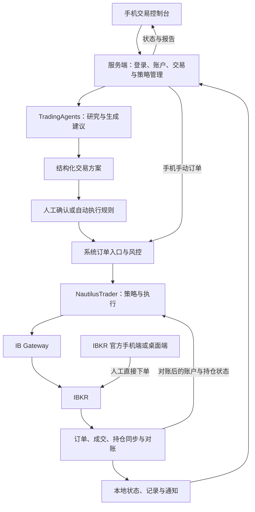

# IBKR AI 交易系统：目标与任务大纲

更新日期：2026-10-23  
状态：需求与架构大纲；尚未实施。具体技术方案、接口与验收细节以 TODO 后续补充。

> 阅读说明：「已确认」来自本次讨论；「设计方向」是待细化的实现建议；TODO 表示尚未验证或决定，不能当作已经支持的功能。

## 1. 整体目标（已确认）

- 搭建个人使用的完整交易系统，整合 TradingAgents、NautilusTrader 和 IBKR。
- TradingAgents 负责 AI 研究与交易建议，NautilusTrader 负责策略运行、回测及交易执行，IBKR 负责账户和实际交易。
- 手机可以远程查看账户、研究报告、策略与订单状态，并通过自建界面下单、管理系统。
- 保留直接通过 IBKR 官方客户端下单的使用方式；系统需要同步这些外部交易及其账户影响。
- 支持手机手动下单、AI 建议确认后下单、AI 自动交易三种模式。
- 从完整目标规划架构，逐项细化和实现；当前只记录框架，不展开详细方案。

## 2. 已确认的约束与范围

- AI 使用云端模型，不部署本地大模型。
- 当前考虑 Mac mini M6、24GB 内存、512GB SSD；尚未完成实际负载验证，不将该配置视为无限并发保证。
- 行情通过 API 按需获取或订阅，只缓存必要数据；长期存储全市场逐笔行情或完整期权链不是既定需求。
- 用户不会同时让 Agent 下单和自己在 IBKR 下单；无需优先设计复杂的人工与 AI 同时交易协调机制。
- 仍需保留基本订单去重、超时核查和恢复能力：这些问题即使只有一个交易主体也可能出现。
- 期权专用界面和自动执行降低优先级，作为后续开发内容。
- 暂不创建交易连接、不配置密钥、不发送真实订单。

## 3. 总体流程（设计方向）

> 注释：此图表达业务关系，不承诺所有订单类型、外部订单来源和跨会话状态都已被现有适配器覆盖。同步机制与可见性需验证。
>
> 修正此前讨论：「统一订单入口」只约束我们系统发出的订单。用户可以绕过本系统，在 IBKR 官方客户端下单；这些订单通过同步与对账进入系统，而非强制从自建手机端提交。

## 4. 人工交易与 Agent 交易的切换

- 设计方向：人工模式、Agent 模式、切换/对账中状态。
- 人工模式：暂停 Agent 发出新的交易指令，研究、报告和账户同步可以继续。
- Agent 模式：基于完成对账后的账户、挂单和持仓继续决策。
- 原有挂单可能在切换后继续成交；暂停策略、撤单、平仓是独立操作，不默认互相等同。
- 外部订单默认用于观察与对账，不自动交给 Agent 修改、撤销或作为本策略订单管理。

TODO：
- [ ] 定义模式切换入口、在途订单处理以及原有保护订单的处理规则。
- [ ] 定义 Agent 恢复前的同步检查；尚未确认的订单结果不得触发盲目重发。
- [ ] 明确如何将人工持仓计入账户风险，以及是否允许 Agent 后续管理人工持仓。

## 5. 需要开发的模块

| 模块 | 目标与工作范围 | 备注 |
| --- | --- | --- |
| 手机控制台 | 账户、持仓、自选股、报告、订单、下单/撤单/改单、模式切换、策略控制 | 设计方向为手机网页/PWA；具体界面 TODO |
| 认证与远程访问 | 登录、会话、设备、交易权限、加密连接 | 模型密钥和券商凭据留在服务端；方案 TODO |
| 服务端 API | 查询、交易命令、任务管理、实时状态推送 | 框架、进程划分和接口 TODO |
| AI 任务管理 | 手动/定时研究、任务队列、报告保存、模型配置、费用与调用统计 | 复用 TradingAgents；调度与管理自行开发 |
| AI 决策转换 | 将分析转换为明确的合约、方向、数量、价格、有效期和依据 | 缺失字段、过期建议、重复建议处理 TODO |
| 系统订单入口与风控 | 手机和 AI 订单的校验、权限、金额/仓位限制、状态追踪 | 复用引擎已有能力，补账户级规则；细则 TODO |
| NautilusTrader 桥接 | 交易命令、策略启停、行情/执行事件、状态回传 | 复用 IBKR 适配器，不默认重写券商接口 |
| 外部订单同步与对账 | 同步 IBKR 官方端产生的订单、成交、持仓、账户变化 | 核心需求；单独验证，见第 6 节 |
| 数据与记录 | 订单、成交、AI 决策、策略配置、操作日志、必要缓存 | 数据库选择、保留周期、备份 TODO |
| 运行与告警 | 启动、异常恢复、断线/登录失效提醒、备份和更新 | 包括 IBKR 人工重新认证的维护入口 |
| 回测与研究任务 | 历史数据按需获取、任务管理、结果展示、并发限制 | 与实时执行隔离资源；详细调度 TODO |

## 6. IBKR 官方端订单如何同步（重点 TODO）

### 6.1 同步目标

- 展示可获取的未完成订单、订单状态、成交、持仓和账户变化。
- 区分本系统订单和外部订单；无法确认来源的记录不擅自标记成人工订单。
- 将 IBKR 返回的实际账户状态作为对账依据，保留本地操作与决策记录。
- 同步结果供手机展示和 Agent 后续决策使用，避免 Agent 根据过期持仓继续交易。
- 连接可用时尽量及时更新；会话中断期间显示状态时间和未同步标记，恢复后补取并对账。

### 6.2 待研究的实现路径

- [ ] 验证 NautilusTrader 所选版本的 IBKR 适配器对外部订单、成交、持仓报告的覆盖范围。
- [ ] 验证 IBKR Mobile、TWS、Client Portal 分别创建的订单在目标 API 会话中是否可见，以及可见时间和权限边界。
- [ ] 比较事件订阅、定期查询、启动/重连对账的组合；区分未完成订单、已完成订单、成交和持仓查询，不能仅靠挂单列表恢复全部历史。
- [ ] 研究 TWS API 的 reqAllOpenOrders、reqOpenOrders、reqExecutions、reqCompletedOrders 及账户/持仓订阅等候选能力；确认历史窗口与会话限制，暂不锁定方案。
- [ ] 确认 client ID、Master Client 配置、用户名和交易会话对外部订单可见性与修改权限的影响。
- [ ] 区分「读取/同步」与「绑定后管理」；不要仅为同步就自动绑定订单。IBKR 文档说明 reqAllOpenOrders 不绑定订单，绑定行为和副作用须单独核验。
- [ ] 确认登录 IBKR 官方客户端是否影响服务器连接；评估人工交易期间断开、切回后对账，或符合账户权限的其他会话安排。
- [ ] 设计账户、合约、订单和成交标识映射及去重；验证跨客户端、跨会话的标识稳定性。
- [ ] 对无法通过在线 API 补齐的较早历史，评估是否需要券商报表等补充来源。
- [ ] 明确外部订单只读展示与允许系统接管的边界；接管不作为同步的默认前提。

> 注释：用户不同时进行人工和 Agent 交易，可以降低并发协调复杂度，但仍需解决切换期间的在途成交和会话恢复。这部分先研究清楚，再制定详细接口方案。

## 7. 期权功能（后续、低优先级）

- 单腿期权选择：到期日、行权价、Call/Put、报价、乘数。
- 多腿组合构建、净价和成交状态展示。
- Greeks、保证金等可用数据的展示及时间标识。
- 到期、行权、指派相关记录与提醒。

TODO：
- [ ] 逐项核验所选 NautilusTrader 版本、IBKR 适配器与账户权限支持的合约及订单类型。
- [ ] 核验单腿、多腿组合、止损/止盈关联、改单/撤单和部分成交行为。
- [ ] 核验 Greeks、保证金预估、历史期权数据的来源、限制及订阅要求。
- [ ] 核验行权、指派、到期事件如何反映到订单、持仓和对账流程。
- [ ] 即使期权交易界面后置，也要明确账户已有期权持仓如何展示并计入总风险。

## 8. 数据、硬件与部署边界

- 不预设必须建设完整历史行情库；按实际策略需求获取、缓存数据。
- 持久保存订单/成交、AI 决策依据与结果、配置、审计记录和必要的策略恢复状态。
- 手机只负责交互；关闭手机页面不应停止服务器上的任务。
- AI 云端调用、后台服务、浏览器和回测分别限制并发；回测不能无限占用实时交易资源。

TODO：
- [ ] 确定具体标的规模、数据粒度、分析频率、回测跨度和并发量，再验证 24GB/512GB 配置。
- [ ] 固定 TradingAgents、NautilusTrader、IB Gateway 的版本与相容依赖，避免混用不同版本文档和示例。
- [ ] 决定数据库、缓存、部署方式、启动恢复、远程访问及通知渠道。
- [ ] 制定日志/缓存保留、备份恢复与后续外置存储方案。

## 9. 后续任务大纲与验收方向

- [ ] 将本大纲细化为可实现的模块边界、数据流与接口方案。
- [ ] 优先研究外部订单同步、IBKR 会话切换和 Agent 恢复规则。
- [ ] 明确手机页面与三种交易模式的交互。
- [ ] 明确 AI 交易方案格式及程序风控规则。
- [ ] 补充选定版本的功能支持矩阵和缺口清单。
- [ ] 制定验证场景：手机订单、AI 建议确认、自动执行、IBKR 官方端人工交易后同步、人工/Agent 切换。
- [ ] 制定故障验证：重复请求、结果未知、部分成交、网络中断、进程重启、AI 超时、登录失效。
- [ ] 验证手机展示与券商实际订单/持仓一致，未确认状态不伪装成成功。
- [ ] 期权专用功能在上述核心流程之后单独细化。

### 权限放开与上线门槛

执行权限按能力逐级开放，而不是只设一个“自动交易”总开关：

1. **研究模式**：AI 只能读取经过筛选的数据并生成报告，不能调用交易命令。
2. **信号模式**：生成结构化交易方案和提醒，由人工在系统或 IBKR 官方端处理。
3. **模拟执行**：走完整订单、风控、状态和恢复流程，但只连接 IBKR 模拟账户。
4. **受限实盘**：固定账户、标的、方向、单笔/总仓位/当日损失限额；逐项通过验收后开放。

设计约束：

- Web、手机、定时任务和 Agent/MCP 只能调用同一套服务端业务接口与风控入口，不能各自直连券商形成旁路。
- Agent 使用独立、可撤销、按 Scope 限权的令牌；不接收券商凭据、管理员会话或账户登录信息。
- 开放 Agent 实盘至少需要「Agent 令牌允许实盘」与「服务器允许 Agent 实盘」两个独立条件；任一关闭都不能提交真实订单。
- AI 审核或研究服务不可用时，不得绕过账户新鲜度、权限、仓位、损失、重复订单和未知结果检查。确定性风控始终在执行前生效。
- 回测、模拟盘和小额实盘使用同一种订单意图与风控契约，避免上线时换一套未经验证的路径。

## 10. 后续核验参考

### 已整理的选型调研

- [TradingAgents 能力与替代项目](RESEARCH_TRADINGAGENTS.md)
- [NautilusTrader 能力与替代产品](RESEARCH_NAUTILUSTRADER.md)
- [WealthLens：资产看板与复用边界](RESEARCH_WEALTHLENS.md)

2026-10-22 源码核查补充：

- TradingAgents 的账户上下文是研究摘要，不是完整券商账本；需要独立保存账户快照及其完整性、时间和合约身份。
- NautilusTrader 当前核查版本的 client ID 限制与 IBKR 手工 TWS 订单绑定要求存在适配边界；当前仍以同步展示为目标，不默认接管手工订单。
- LumiBot 已有 Agent 工具权限、账户读取检查和同步恢复代码，保留为完整替代候选；这些能力不等于 IBKR Mobile 工作流已通过验证。
- WealthLens 纳入资产展示与多账户汇总的参考；已有 IBKR 资金/持仓读取，但缺少订单/成交对账与执行。暂不作为账户核心依赖；复用前需处理数据字段、默认资产数值、手机 API 地址及许可不一致，详见独立报告。
- [ ] 按执行层调研第 10.5 节核验人工订单、部分成交、离线恢复、未知结果及模式切换。
- [ ] 将真实成交与为对账生成的合成事件区分保存；历史缺口不得伪装成完整成交记录。
- [ ] 将仓位限额和账户新鲜度放在程序校验中，独立于 Agent 的文字规则。

注：调研记录候选方案及限制，尚未替换本大纲中的技术选型；最终选择需结合外部订单同步、人工/Agent 切换与 Mac 部署验证。

- [TradingAgents 项目与 README](https://github.com/TauricResearch/TradingAgents)
- [NautilusTrader：IBKR 适配](https://nautilustrader.io/docs/latest/integrations/interactive_brokers/)
- [NautilusTrader：执行对账](https://nautilustrader.io/docs/latest/concepts/execution/reconciliation/)
- [NautilusTrader：实时节点配置](https://nautilustrader.io/docs/latest/how_to/configure_live_trading/)
- [IBKR：订单修改与绑定](https://www.interactivebrokers.com/docs/tws-api/doc/orders/modifying-orders)
- [IBKR：API 与其他交易应用并用说明（旧版文档，实施时重新核验）](https://interactivebrokers.github.io/tws-api/third_party.html)

> 参考文档用于后续核验；此大纲未承诺已经实现实时外部订单同步，也没有把项目自述能力当作本系统已完成的验证。

## 11. 共享会话对照与可借鉴内容（2026-10-23）

对照来源：[共享的 ChatGPT 会话](https://chatgpt.com/s/t_6adb5cc9145c8191abe2312130bd6987)。会话中的产品结论属于二手分析；本节仅把其中的架构观点与已核对项目资料结合，不把会话本身当作产品支持证明。

### 与当前方案一致的部分

- TradingAgents 是研究与建议层，NautilusTrader 是策略、回测与执行引擎，两者可以组合，不是二选一。
- AI 输出后必须经过 Python/程序化的确定性风控，再进入执行层；LLM 不应取得不受限的真实订单权限。
- 执行层可以在 LumiBot、NautilusTrader 或自建 IBKR 接入中选择，手机/Web 属于独立的监控与交互层。
- 应先验证回测和 IBKR 模拟账户，再逐步开放实盘。

这些原则已体现在第 3、5、6、9 节。当前大纲比共享会话多覆盖了一个关键问题：用户在 IBKR 官方端下单后的订单、成交、持仓同步，以及人工/Agent 模式切换和结果未知时的恢复。

### 选型排序不完全一致

共享会话把 LumiBot 列为快速形成闭环的第一选择，把 TradingAgents＋NautilusTrader 列为更灵活但集成工作更多的第二选择。这是合理的“原型速度”排序，但不能直接替换本项目的“长期完整系统”排序。

当前继续保留：

- **主候选：TradingAgents＋NautilusTrader**，重视研究/执行解耦、事件状态和后续扩展。
- **完整替代候选：LumiBot**，重视一体化与较低桥接成本；须通过相同的 IBKR 外部订单、恢复、程序风控和 Mac 部署验收。

在上述验收完成前，不以代码量较少、示例较多或项目自称一体化来决定最终方案。

### QuantDinger：会话中新增的候选

共享会话提到的 [QuantDinger](https://github.com/OpenByteInc/QuantDinger) 确有 Web、Mobile H5、Agent Gateway/MCP、回测、模拟/实盘、IBKR 接口和监控组件，不只是界面概念。其文档采用“Human API 与 Agent 共用服务层”、Agent Scope 令牌、默认 paper-only 和服务器实盘总开关，这些设计值得借鉴到第 9 节。

但当前官方安全文档把 IBKR/Alpaca 的美股实盘限定为只做多；已读 IBKR 指南列出账户、持仓、订单、下单和撤单接口，没有证明期权、IBKR Mobile 外部订单归属、跨会话成交补齐和人工/Agent 切换满足本项目要求。它还包含 PostgreSQL、Redis、Kafka、Celery workers，以及可选 Prometheus/Grafana/Alertmanager，完整部署比单一交易库更重，需在 M6 24GB/512GB 上实际测量。

来源：[固定提交 README](https://github.com/OpenByteInc/QuantDinger/blob/d7642d7e46a3c4070e1a156731f4e53c7646e78c/README.md)、[IBKR 指南](https://github.com/OpenByteInc/QuantDinger/blob/d7642d7e46a3c4070e1a156731f4e53c7646e78c/docs/trading/IBKR_TRADING_GUIDE_CN.md)、[实盘安全边界](https://github.com/OpenByteInc/QuantDinger/blob/d7642d7e46a3c4070e1a156731f4e53c7646e78c/docs/trading/LIVE_TRADING_SAFETY_CN.md)。

TODO：

- [ ] 单独核查 QuantDinger 的 IBKR 适配器源码：订单可见范围、成交/佣金、重连、幂等、外部订单和账户选择。
- [ ] 核查其 Mobile H5 的认证、同源 API、实时状态、人工确认和远程访问方案，判断哪些可复用到自建手机端。
- [ ] 核查 Agent Gateway 的实际工具权限，确保研究 Agent 无法通过通用接口绕过系统风控。
- [ ] 用同一套验收场景比较 NautilusTrader、LumiBot 和 QuantDinger；比较对象是完整账户工作流，不只是下单成功。
- [ ] 在目标 Mac 上分别测量核心栈和附加监控栈的空闲/峰值内存、CPU、磁盘增长与故障恢复时间。

